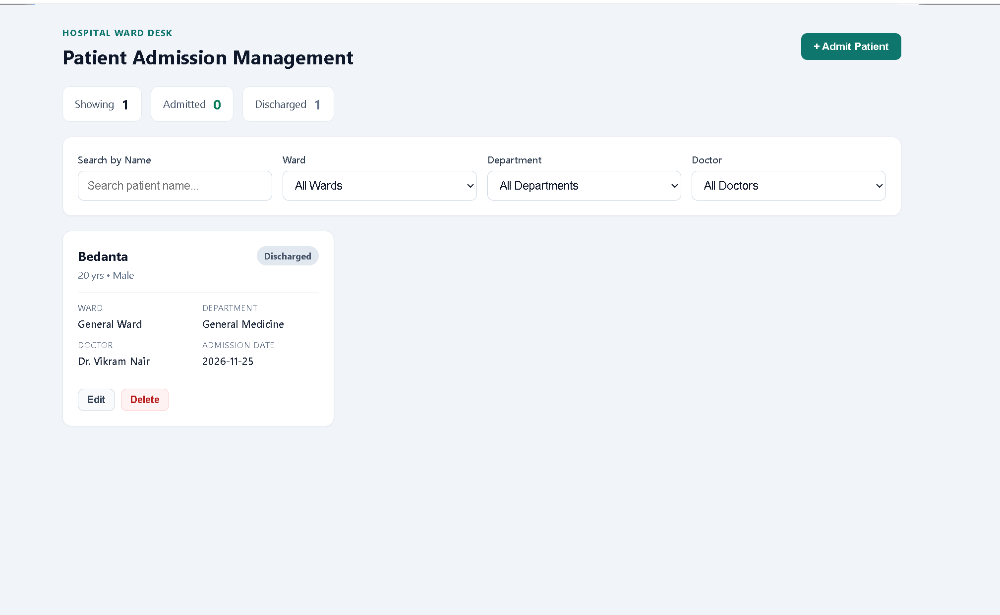
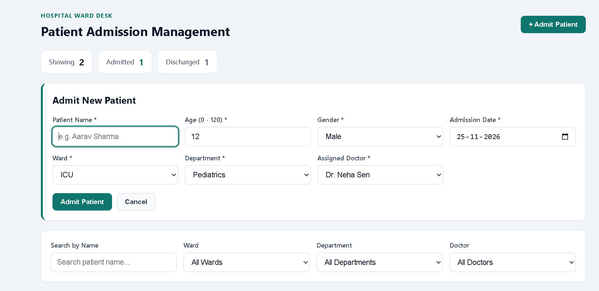
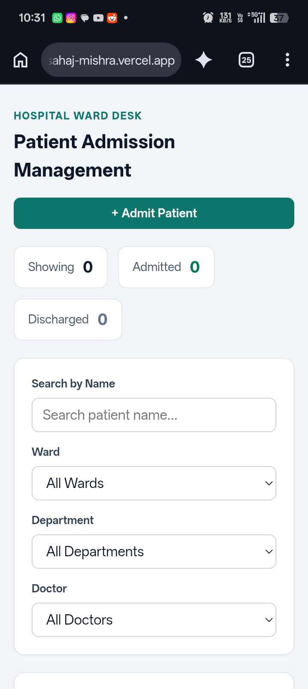
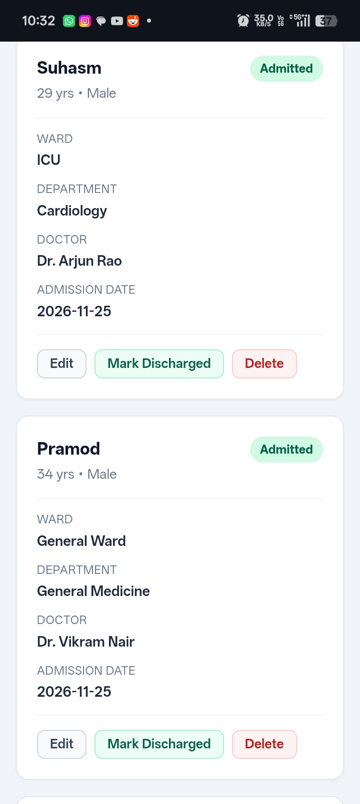

# Patient Admission Management App

A full-stack web application for hospital ward staff to admit, view, search, filter, edit, discharge, and manage patients with validation enforced on both the React frontend and Django backend.

## Live Demo

- **Live Application (Frontend):** [[https://YOUR_LIVE_VERCEL_URL.vercel.app](https://d-scribe-ta-sahaj-mishra.vercel.app/)](https://YOUR_LIVE_VERCEL_URL.vercel.app)
- **Backend API Health Check:** [[https://YOUR_RENDER_BACKEND_URL.onrender.com/api/health/](https://dscribe-patient-api-jhxa.onrender.com/api/health/)](https://dscribe-patient-api-jhxa.onrender.com/api/health/)](https://YOUR_RENDER_BACKEND_URL.onrender.com/api/health/)

> **Note:** The backend API is hosted on Render's Free tier, so the very first request after 15 minutes of inactivity may take ~30–50 seconds while the server wakes up.

---

## Tech Stack

- **Frontend:** React.js (Vite), JavaScript (ES6+), Fetch API, Responsive CSS3
- **Backend:** Python 3.13, Django 6, Django REST Framework, `django-cors-headers`, Gunicorn
- **Database:** PostgreSQL (Neon Serverless in production; SQLite fallback for zero-config local development)
- **Deployment:** Vercel (Frontend) + Render (Backend) + Neon (PostgreSQL Database)

---

## Features Implemented

1. **Add a Patient** — Admit new patients with Name, Age, Gender, Ward, Department, Assigned Doctor, Admission Date, and automatic `Admitted` status.
2. **View All Patients** — Clean card layout displaying all patient fields and live count badges (`Showing`, `Admitted`, `Discharged`).
3. **Filter Patients** — Filter by **Ward**, **Department**, and **Doctor** individually or combined.
4. **Search by Name** — Case-insensitive partial name search powered by the backend API.
5. **Edit a Patient** — Update any existing patient's details with pre-filled form values.
6. **Delete with Confirmation** — Confirmation dialog before deleting a patient record.
7. **Mark as Discharged** — One-click action to transition an admitted patient to `Discharged`.
8. **Responsive Design** — Works cleanly across Desktop, Tablet, and Mobile viewports.
9. **Frontend & Backend Validation** —
   - **Name:** Required, letters and spaces only.
   - **Age:** Required, whole number between `0` and `120`.
   - **Gender, Ward, Department, Doctor:** Required, validated against allowed list options.
   - **Admission Date:** Required, cannot be a future date (checked in IST `Asia/Kolkata`).
   - Clear field-level validation error messages returned by the backend and displayed in the UI.

---

## Screenshots

### Desktop Dashboard & Filters


### Admit / Edit Patient Form & Validation



### Mobile Responsive View




---

## Project Structure

```text
├── backend/
│   ├── config/          # Django settings, root URL routing, WSGI
│   ├── patients/        # Patient model, serializer validation, viewset, API URLs
│   ├── manage.py
│   └── requirements.txt
├── frontend/
│   ├── src/
│   │   ├── App.jsx          # Main dashboard, API calls, search & filter state
│   │   ├── PatientForm.jsx  # Add/Edit form + client/server validation messages
│   │   ├── PatientList.jsx  # Responsive patient cards & action buttons
│   │   ├── constants.js     # API base URL & dropdown option lists
│   │   └── App.css          # Responsive desktop/tablet/mobile styles
│   └── package.json
└── screenshots/

```


## API Endpoints

Method	Endpoint	Description
GET	/api/health/	Health check ({"status": "ok"})
GET	/api/patients/	List patients (supports ?search=, ?ward=, ?department=, ?doctor=)
POST	/api/patients/	Admit a new patient
PUT	/api/patients/<id>/	Update patient details
DELETE	/api/patients/<id>/	Delete a patient
POST	/api/patients/<id>/discharge/	Mark patient as Discharged


## Steps to Run Locally
Prerequisites
Python 3.12+
Node.js 20.19+ / 22+ and npm
1. Clone the Repository
Bash

git clone https://github.com/sahajmishr/DScribeTA-Sahaj_mishra.git
cd DScribeTA-Sahaj_mishra
2. Start the Django Backend (Terminal 1)
Bash

cd backend
python -m venv venv

# Windows PowerShell:
.\venv\Scripts\Activate.ps1
# macOS / Linux:
# source venv/bin/activate

pip install -r requirements.txt
python manage.py migrate
python manage.py runserver
Backend runs at http://127.0.0.1:8000 (uses local db.sqlite3 automatically—no .env file needed).

3. Start the React Frontend (Terminal 2)
Open a second terminal from the project root:

## Bash

cd frontend
npm install
npm run dev
Open http://localhost:5173 in your browser.